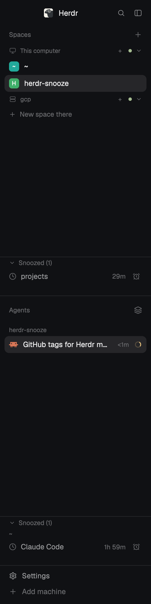

# herdr-snooze

A [Herdr](https://herdr.dev) mod that snoozes spaces. Hover a space in the sidebar, click its
clock and pick a duration. The space, with its worktrees when it is a repo's main space, leaves
the list until the time is up. A **Snoozed** section at the bottom of the sidebar shows each
snoozed space with its time left. Click one to wake it early.



## Install

1. Copy the mod into your Herdr home:

   ```sh
   git clone https://github.com/o101k/herdr-snooze
   cp -R herdr-snooze/mods/snooze ~/.config/herdr-app/mods/snooze
   ```

   To work on the mod, symlink the folder instead of copying it. Herdr reloads on every save.

2. Point a layout of your own at it. Herdr's shipped layouts are read-only, so clone one first
   if you only use those:

   ```sh
   herdr-app do layout.clone '{"name":"main","as":"my-main"}'
   ```

   In `~/.config/herdr-app/layouts/<your layout>.json`, change the spaces block's content from
   `{ "mod": "spaces" }` to:

   ```json
   { "mod": "snooze", "props": { "durations": ["15m", "30m", "1h", "2h", "4h"] } }
   ```

3. Run `herdr-app check ~/.config/herdr-app/mods/snooze`, then confirm that `herdr-app status`
   shows no errors.

## Configure

- **Durations**: the `durations` prop above. Use numbers with `m`, `h`, `d` or `w`, and combine
  them if you like (`1h30m`). The picker also takes a typed duration.
- **A key**: to open the picker for the shown space, add a binding to
  `~/.config/herdr-app/keys.json`:

  ```json
  { "global": { "alt-shift-z": "mod.open:snooze" } }
  ```

## Limits

- Snoozing hides a space only in this sidebar. `space.next`/`space.prev`, `space.select` by
  index and the Agents list still reach it.
- The sidebar is a copy of Herdr's shipped `spaces` mod, because a mod can't import another mod.
  It won't pick up Herdr's later changes to that sidebar.
- Like the shipped sidebar, it runs `git` in your spaces' folders and `hc machine` commands.

See [RECIPE.md](RECIPE.md) for the full brief.
