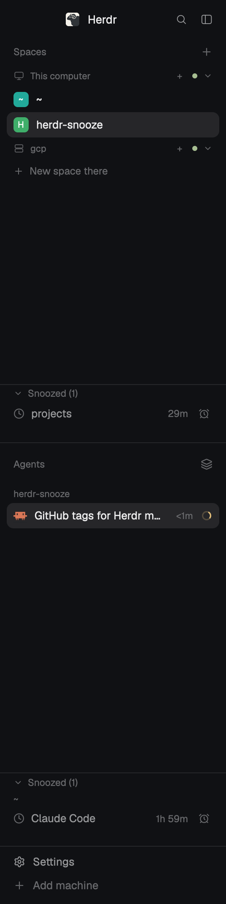

# Snooze

Herdr's Spaces sidebar with a snooze button. Hover a space and click its clock to put it away
for 15 minutes, an hour or any time you type. The space leaves the list, along with its worktrees
when it is a repo's main space, and waits in a **Snoozed** section at the bottom that counts down
the time left. When the time is up, the space comes back and a toast takes you to it. Click a
snoozed space to wake it early. Agents work the same way: a clock on each agent in the Agents
list, and a Snoozed section below it.

## What you see

- **The space list**, as in Herdr's own Spaces sidebar: colored avatars, worktree spaces nested
  under their repo's space, machine groups, and git branch and ahead/behind on the right.
- **A clock button** (13px icon in a 20×20 button, `dim` text, `raised` background on hover) at
  the right end of the row the pointer is on. Its tooltip says "Snooze", or "Snooze with its N
  worktrees" on a repo's space that has worktrees nested under it.
- **The picker**, a 260px popup at the pointer. Its title is "Snooze <space>", plus "+N
  worktrees" when they go along. One 28px row per duration: "15 minutes" on the left and
  "until 03:33" on the right in `dim` (a weekday is added past today). The highlighted row has
  the `selected` background. A text field follows: "Custom: 45m, 1h30m, 2d". Input it can't
  read gets a `blocked` border and a one-line hint.
- **Snoozed (N)**, under the list with a top border: a folding header (chevron) and up to 180px of
  rows, soonest first. Each row has a clock icon, the space name (in `muted`, with "+N" for
  worktrees snoozed with it), the time left ("<1m", "45m", "2h 14m", "1d 3h") and a wake button
  (an alarm clock icon). In the narrow rail (sidebar under 160px), it is one clock icon with
  the count, and a tooltip lists each space with its time left.

- **Agents**: the Agents list as Herdr ships it. A hovered row shows the clock button just
  before its pin button. A **Snoozed (N)** section under the agents works like the spaces one,
  with a clock icon, name, time left and wake button. Clicking a row wakes the agent and
  focuses its pane.

## How it behaves

- Clicking the clock opens the picker for that space. It doesn't select or drag the row.
- In the picker, ↑/↓ move the highlight. Enter snoozes for the highlighted duration, or for the
  typed one when the field has text. A click on a row snoozes for that duration. Esc closes the
  picker.
- Durations are numbers with units: `m`, `h`, `d` and `w`. They can be combined (`1h30m`) and
  can be decimal (`1.5h`). A bare number means minutes.
- Snoozing the space you're in moves you to the next space still listed, or the previous one
  when there is no next.
- Snoozing a repo's main space also hides the worktree spaces nested under it at that moment.
  Snoozing a worktree hides only that worktree.
- Every 30 seconds, the time left updates and due snoozes end. A due space comes back and an
  info toast says "<space> is back". Clicking the toast selects it.
- Clicking a snoozed row wakes the space and opens it. The wake button only wakes it.
- A space closed while snoozed is forgotten, once its machine's layout is readable.
- Snoozes persist across restarts, in shared state.
- A snoozed agent leaves the Agents list and the order `agent.next`/`agent.prev` follow. It
  comes back when its time is up (with a toast that focuses it), when it is woken, or as soon
  as it reports `blocked`. A snoozed agent whose terminal ended on this computer is forgotten.
- `mod.open {name: "snooze"}` (bind it in keys.json) opens the picker for the shown space.
  Worktrees aren't included that way.
- Agent status isn't shown on snoozed spaces, the same as on listed ones. The Agents list still
  shows agents in snoozed spaces.

## Built from

- One mod folder, `mods/snooze/`, with three roles. `main.js` default-exports a `View` that
  delegates to `Picker` when `props().overlay` is set, to `AgentsSidebar` when
  `props().role === "agents"`, and otherwise to `Sidebar`. The picker takes
  `{agent, name}` instead of `{space, with}` for an agent. Both are plain
  classes with `init`/`render`.
- `agents.js` is a copy of the shipped `mods/agents/main.js`, also marked `snooze:`. It filters
  out `shared("snooze.agents")` = `{ [address]: { until, at, name } }` before `setAgentOrder`.
  Use it in the layout with `props.role: "agents"`. Its sort popup still opens the shipped
  `agents` mod.
- `sidebar.js` is a copy of Herdr's shipped `mods/spaces/main.js`. Every change is marked
  `snooze:`.
  - `ordered()` filters the snoozed spaces out only at its final `return`. Its `space.move`
    reorder must still see every space, or it keeps moving them.
  - It records each repo's nested worktree ids in `kidsOf`.
  - `on_hover` tracks the hovered row.
  - The button stops left mouse down, mouse up and click, because the row selects and drags on
    down/up.
- `picker.js`: `InputState`/`Input` from `gpui-base`, `on_key_down` on a tracked focus handle,
  and `closeOverlay`.
- `store.js`: state in `shared("snooze.spaces")` = `{ [spaceId]: { until, at, name, machine, with } }`,
  with `hiddenIds`, `snooze`, `wake`, `sweep` (expiry and pruning), `parseDuration`, `describe`,
  `left` and `clock`.
- Layout block: `{ "mod": "snooze", "props": { "durations": ["15m", "30m", "1h", "2h", "4h"] } }`
  in place of the `spaces` block. The sidebar passes `durations` to the picker in `openOverlay`
  props.
- Commands used: `space.select`, `space.move` and `space.new` (from the copy), and
  `openOverlay`/`notify`. It inherits the shipped sidebar's programs: `git` (branch and
  ahead/behind) and `hc machine ls`/`add`/`rm` (machine groups and reconnect).
- Icons: `clock.svg` and `alarm.svg` (Lucide, ISC). It also reuses
  `mods/workspace-chrome/{plus,chevron-*,branch,server,monitor}.svg`.

## Watch out

- A mod can't import another mod's files ("resolves outside the application directory"), so the
  sidebar has to be a copy of `spaces`. It won't follow Herdr's updates to the shipped sidebar.
  Re-copy and re-apply the `snooze:` changes to catch up.
- Hiding happens in this sidebar only. `space.next`/`space.prev`, `space.select {index}` and
  the Agents list still reach snoozed spaces.
- `.child(null)` throws. Add the Snoozed section with `.when(...)` only when there are entries.
- Shipped layouts are read-only. Point a layout of your own (or a `layout.clone` of `main`) at
  `snooze`.
- With several copies shown (one per layout), each sweeps. The shared write is idempotent, but
  a toast can appear twice.

## Done when

- Hovering an agent shows the clock before the pin. Snoozing it moves it to the agents'
  Snoozed section, and the row wakes it and focuses it.

- `herdr-app check ~/.config/herdr-app/mods/snooze` passes.
- Hovering a space shows the clock, and clicking it opens the picker without switching spaces.
- Picking "15 minutes" removes the space from the list. The Snoozed section shows it with "14m".
- Snoozing a repo's main space hides its nested worktrees, and the row shows "+N".
- Clicking the snoozed row brings the space back and opens it.
- A `1m` snooze returns by itself within about 90 seconds with a "<space> is back" toast.
- Typing `abc` in the picker shows the hint and doesn't close the picker.
